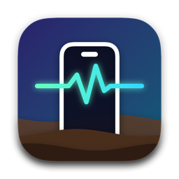
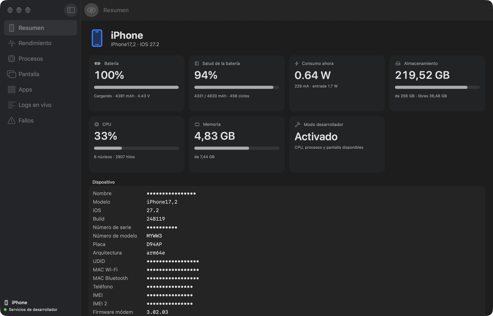
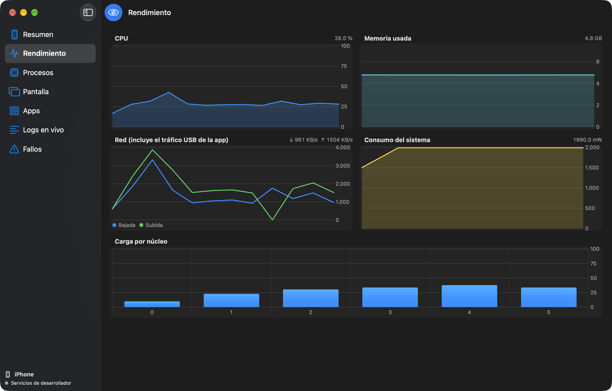
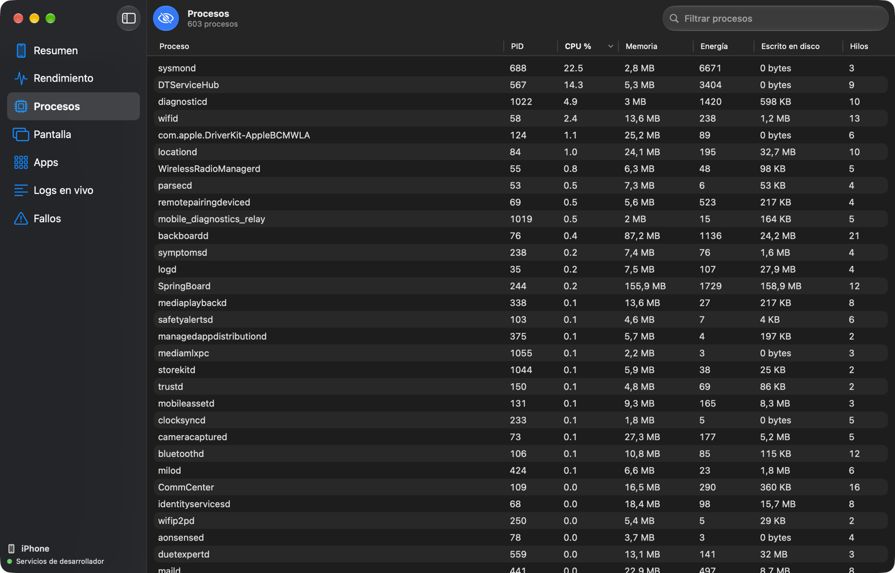

<p align="center"></p>

<h1 align="center">iPhone Digger</h1>

<p align="center">
Panel de observabilidad en vivo para iPhone, nativo para macOS.<br>
Conecta un iPhone por cable y mira lo que pasa dentro: batería, CPU, memoria, procesos, pantalla, apps, logs y fallos.
</p>

<p align="center"></p>

> *English:* native macOS (SwiftUI) dashboard that streams live data from any USB-connected iPhone — battery health and power draw, CPU/memory/network, every process, screen mirroring, installed apps with sizes and declared permissions, the live system log and crash reports. Built on [pymobiledevice3](https://github.com/doronz88/pymobiledevice3). UI in Spanish.

## Qué muestra

| Sección | Datos | Requiere modo desarrollador |
|---|---|:-:|
| **Resumen** | Modelo, iOS, número de serie, IMEI, MACs, almacenamiento, batería (nivel, salud real en mAh, ciclos, voltaje, amperaje), consumo del sistema en vatios | No |
| **Rendimiento** | Gráficas en vivo de CPU, memoria, red, consumo y carga por núcleo | Sí |
| **Procesos** | Todos los procesos (≈600) con CPU, memoria, energía, escrituras a disco e hilos; ordenables y filtrables | Sí |
| **Pantalla** | Captura de la pantalla o espejo en vivo (~3 fps), con opción de guardar en PNG | Sí |
| **Apps** | Apps instaladas con tamaño (binario + datos), permisos que declaran y modos de segundo plano | No |
| **Logs en vivo** | El log del sistema en tiempo real, filtrable por proceso o texto | No |
| **Fallos** | Informes de fallos (`.ips`), ranking de los procesos que más fallan y visor del informe completo | No |

**Modo privado** (botón del ojo o ⇧⌘P): oculta el nombre del dispositivo, número de serie, UDID, IMEI, teléfono y MACs para poder compartir capturas.

Funciona con **cualquier iPhone** emparejado con el Mac. Con varios conectados aparece un selector en la barra de herramientas.

<p align="center">


</p>

## Requisitos

- macOS 14 o superior (Apple Silicon o Intel)
- Xcode 15 o superior para compilar
- Python 3.10 o superior
- Un iPhone conectado por cable, desbloqueado y con «Confiar en este ordenador» aceptado

Para **Rendimiento, Procesos y Pantalla** el iPhone debe tener activado el **modo desarrollador** (Ajustes › Privacidad y seguridad › Modo de desarrollador; el iPhone se reinicia). Si no aparece la opción, conecta el iPhone con Xcode abierto una vez, o ejecuta `pymobiledevice3 amfi reveal-developer-mode`. La app monta sola la imagen de desarrollador (DDI) la primera vez; para ello se descarga de internet y se firma para tu dispositivo.

## Instalación

```bash
git clone https://github.com/AntonioBriPerez/iphone-digger.git
cd iphone-digger
./setup.sh                      # instala pymobiledevice3 en un entorno propio
open iPhoneDigger.xcodeproj     # y pulsa ⌘R
```

O desde terminal:

```bash
xcodebuild -project iPhoneDigger.xcodeproj -scheme iPhoneDigger -configuration Release -derivedDataPath build build
open "build/Build/Products/Release/iPhone Digger.app"
```

Si ya tienes pymobiledevice3 instalado con `pipx`, la app lo encuentra sin ejecutar `setup.sh`. También puedes indicar otro intérprete con la variable `IPHONE_DIGGER_PYTHON`.

Atajos de lanzamiento útiles:

```bash
open "iPhone Digger.app" --args -page logs -privacy YES   # abre en una sección y con modo privado
```

Valores de `-page`: `overview`, `performance`, `processes`, `screen`, `apps`, `logs`, `crashes`.

## Cómo funciona

La interfaz es SwiftUI nativa. Para hablar con el iPhone usa un pequeño agente en Python ([`agent/agent.py`](agent/agent.py)) basado en pymobiledevice3, que la app lanza como proceso hijo y con el que se comunica por JSON línea a línea. Apple no ofrece una API pública para esto, y pymobiledevice3 es la única implementación abierta que cubre el túnel de iOS 17+ y los servicios de Instruments. Los detalles están en [docs/ARCHITECTURE.md](docs/ARCHITECTURE.md).

No hace falta `sudo`. En iOS 17+ el túnel hacia el dispositivo se establece en espacio de usuario.

## Privacidad

Todo ocurre en tu Mac: la app no envía nada a ningún servidor. La única conexión a internet es la descarga de la imagen de desarrollador de Apple cuando hace falta. Los logs y los informes de fallos pueden contener datos personales, así que revísalos antes de compartirlos.

## Desarrollo

- `project.yml` es la fuente del proyecto de Xcode ([XcodeGen](https://github.com/yonaskolb/XcodeGen)): tras añadir archivos, ejecuta `xcodegen generate`.
- El icono se genera con `swift tools/make-icon.swift`.
- El agente se puede probar sin la app: `python3 agent/agent.py` y escribir comandos como `{"cmd":"apps"}`.

## Licencia

[MIT](LICENSE)
